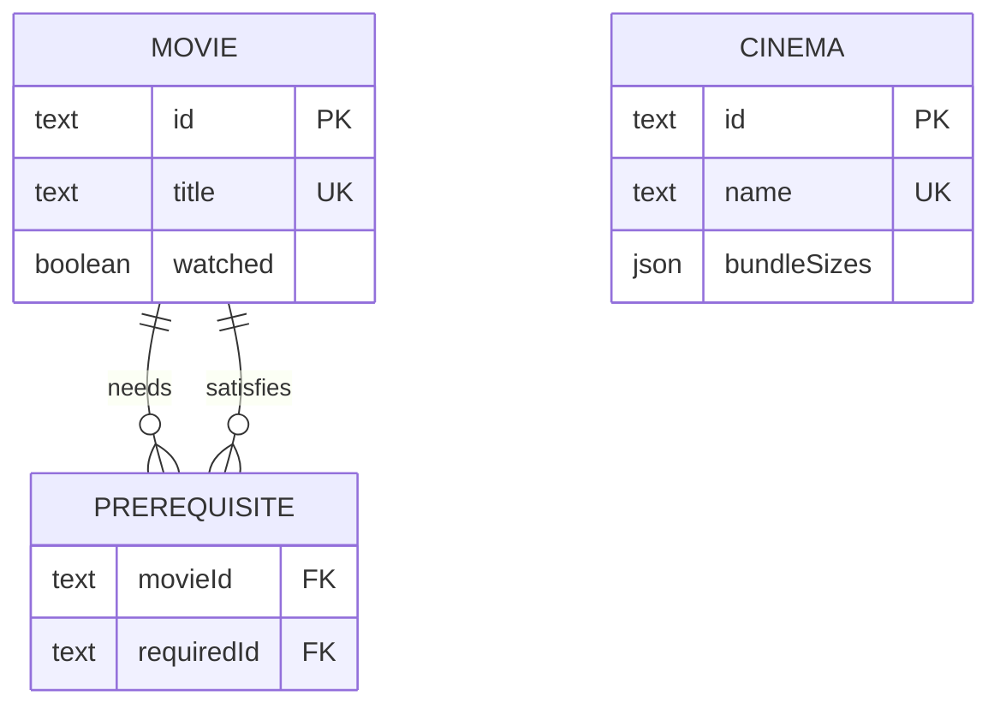

# Doomsday Ready

Doomsday Ready helps a group of Marvel fans decide what to watch before a target film and which cinema bundles to buy for their party.

## Run locally

Use a Node.js release that meets the engine requirement in `package.json`. The app uses the SQLite driver included with Node.

```sh
npm ci
npm run dev
```

Open the local address printed by Next.js. The app creates its database and loads the sample catalog on first use. Movie edits, watched marks, and cinemas are shared by everyone using that installation. By default, the database lives in `data/marathon.sqlite`. Set `MARATHON_DB` to choose a different file.

To run the production build with Docker, use the following command. Compose keeps the database in a named volume across container restarts. The `PORT` environment variable selects the host port.

```sh
docker compose up --build
```

## Using the app

- **Movies** shows the library in release order. Search by title or filter by watch status. Use **Add movie** to add a film, the pencil to edit its details and prerequisites, and the checkbox to change its watch status.
- **Rewatch plan** lists the prerequisites of the selected film in viewing order. Watched marks carry over from the library. A film with no prerequisites can be watched immediately.
- **Booking** calculates an exact seat purchase for the selected cinema and group. Use **Add cinema** to enter another set of available bundle sizes. A quote describes what to buy. Seat reservations and payments are outside the app.

## How the code fits together

The pages in `app` use the JSON API in `app/api`. The interactive library and movie form live in `components`. Buttons, inputs, cards, dialogs, and the progress bar come from the supplied `components/ui` collection. Client requests and their loading and error states live in `lib/client.ts`.

`lib/catalog.ts` validates input and reads and writes records. `lib/db.ts` owns the SQLite connection, schema, and transactions. `lib/seed.ts` contains the editable sample data. The sample movie links and the Doomsday details are planning examples. Cinema names and bundles are fictional.



### Rewatch order

`lib/planning.ts` follows prerequisites from the selected movie. For each film, it visits the required films before adding that film to the list. A set of finished films prevents duplicates when paths meet. A separate set tracks the current path. Reaching a film already on that path produces `CIRCULAR_DEPENDENCY`. The target stays out of its own plan.

Movie edits use the same traversal to check the proposed graph. The check and the write share a transaction, so a rejected edit preserves the previous graph. Titles and cinema names are trimmed and compared without regard to case. Repeated prerequisite IDs collapse into a single link.

### Seat bundles

The booking calculation builds a table of the fewest bundles needed for each possible seat total. An empty group starts with an empty purchase. For each larger total, the algorithm tries each bundle as the final purchase and keeps the smallest reachable count. It records the winning bundle so it can reconstruct the shopping list. An unreachable group size produces an explicit impossible quote.

Bundle sizes are reusable and distinct. Where several exact purchases tie, the app returns one of them. Both planning algorithms are implemented directly in `lib/planning.ts`.

## API

| Method | Path | Purpose |
| --- | --- | --- |
| GET | `/api/movies` | List library entries |
| POST | `/api/movies` | Create a movie |
| PATCH | `/api/movies/:id` | Update supplied movie fields |
| GET | `/api/movies/:id/rewatch-order` | Get the ordered prerequisites and viewing progress |
| GET | `/api/cinemas` | List cinemas and their bundle sizes |
| POST | `/api/cinemas` | Create a cinema with a name and bundle sizes |
| GET | `/api/cinemas/:id/booking?groupSize=…` | Quote a group purchase |

Send writes as JSON objects. See `lib/types.ts` for the field names and response shapes. New movies default to unwatched with an empty prerequisite list. Errors include a machine-readable `error` code and a displayable `message`.

## Checks

```sh
npm test
npm run build
```

The planning tests cover shared prerequisites, cycles, watched progress, a booking where choosing the largest bundle first fails, and groups that cannot be seated exactly.

## AI assistance

Codex helped implement the interface, API, and planning logic, write the tests, and prepare this README. The banner and film illustrations were generated for this project.
